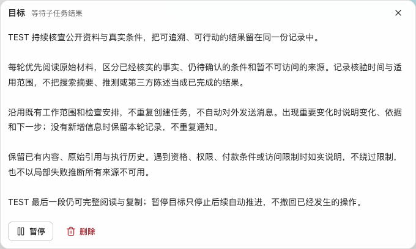
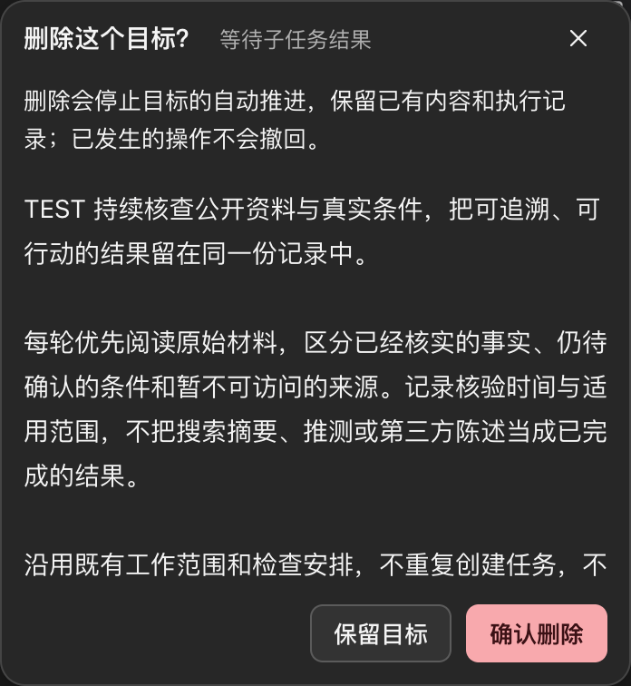
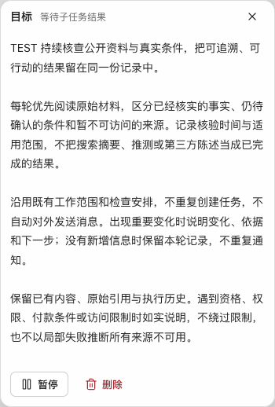

# 目标弹窗：完整视觉复核

日期：2026-10-18。起点提交 `6c14bdcc`。范围是目标查看、确认及必要状态，
不是全 Desktop 视觉改造完成或 shadcn/ui 迁移完成的声明。

## 视觉判断与实现

旧弹窗把暂停与删除做成等权描边按钮并推到两端，相关动作失去接近性；
状态另占一行，标题、正文、动作的层级不够清楚。完整窗口观察也确认：
正文才是主阅读路径，不能为了缩小控件而压缩正文或隐去删除后果。

现在标题与短状态合组，可换行；正文保留 14px／1.75 阅读排版。
暂停与普通删除在同一组、间隔 8px；删除使用安静的危险文字动作，只有
确认删除才用危险实底。确认先交代后果，再展示原目标；安全取消保留
初始焦点，取消后回到删除入口。短目标按内容收缩，不撑出空占位。
共享按钮仍是桌面 32px／粗指针 44px，没有新增一套局部尺寸。

实现过程中，实际截图发现两类源码检查没有拦住的问题：

1. 公共 footer 的旧选择器覆盖了 ghost／danger，造成删除仍是黑色描边。
   修正共享 surface 的明确角色选择器，检查最终 computed 色值和透明边框；
   不加 `!important` 或目标专属颜色副本。
2. 200% 缩放时，侧栏能把中间画布挤成两三个字一行。目标全文声明最小
   可读宽度；共享模态尊重该声明，放不下时使用视口安全范围。没有声明
   最小宽度的弹窗保留原定位，注解浮层继续限制在中间内容区。

另补查 760×400px、200% 的极短窗：正文至少保留一行实际文字，空间
不足时整个模态可滚动，按钮仍可达；不缩字号换取“不越界”。

## 独立复核与资料边界

使用 Impeccable critique／layout／polish 的评审流程和 craft-floor。
官方 [shadcn/ui Dialog](https://ui.shadcn.com/docs/components/dialog) 与
[Button Group](https://ui.shadcn.com/docs/components/button-group) 用来对照
标题、正文、操作分组和长内容行为；实际仍是已有 React／原生 dialog，
没有安装或冒称接入 shadcn/ui。

两名独立评审分别看渲染图与源码／扫描，在首次判断前互不读取对方结论：

- 视觉评审先指出等权分散动作和风险说明顺序；复核亮暗、小屏、短目标、
  200% 长目标确认态后，没有指出仍需调整主体布局或字号的实质视觉问题。
  小屏底部缺少持续滚动提示记为非阻断 P3 观察，尚未增加阴影或额外常驻行。
- 源码评审确认权限、revision、pending、防重试等保护未被削弱。最终
  `SubjectObjectiveDialog.tsx` 单次 detector 退出 0、`[]`；并指出状态选择器
  同级覆盖、短窗正文可能缩没的问题，均修正并加入实际计算样式／高度回归。

这不是覆盖全部启发式的正式总分报告，也没有用 detector 为零替代视觉
判断。浏览器 overlay 未运行，不声称已运行。Gemini 首次图片上传弹出
新的使用声明，首轮交付停在交接步骤，没有代用户接受。随后用户手动
确认，才通过原 Gemini 网页上传文中三张合成截图并取得实际评审，见下节。
原 App 的私人任务正文没有对外发送；文中图片均为隔离测试生成的
合成 TEST 内容。

### 补充：Gemini 外部视觉复核已完成

用户确认声明后，使用原已登录网页、默认 Flash 模式，一次提交三张
合成截图：亮色阅读态、暗色 200% 确认态、390px 窄窗阅读态。提示词
没有附内部评审结论，要求独立指出可见证据、影响和建议，并区分静态
视觉与必须操作验证的交互。没有对外发送源码、私人任务正文或凭据，
没有新建分享链接或修改模型／账号设置。

Gemini 认可行高、克制的主题和窄窗表现，但提出三项批评。外部意见
不是验收事实，以下区分观察、核实和待办：

| 外部意见                                                       | 核对与判断                                                                                                                                                       | 当前状态                                           |
| -------------------------------------------------------------- | ---------------------------------------------------------------------------------------------------------------------------------------------------------------- | -------------------------------------------------- |
| 普通态按钮靠左、确认态靠右，切换时位置不一致；标为 P0          | 位置差异确实存在，是值得修正的一致性问题；没有操作阻断、数据丢失或误操作的实测证据，P0 分级过度。应统一动作区锚点，不恢复两端分散按钮。                          | 未解决；本次补充仅复核，未修改 UI。                |
| 确认说明与目标原文过于相似，状态标签干扰确认；建议增加警示卡片 | 视觉区分不足的观察成立。其“字号相同”的表述不准确：当前说明 13px、正文 14px；数值不同不能替代实际层级。区分系统说明与原文值得改，不意味着必须新增彩色卡片或图标。 | 未解决；应保留后果说明与原文，用最少元素明确区分。 |
| 桌面正文行长过长；建议弹窗 520–600px、中文每行 25–35 字        | 当前已有 680px 上限，并非无上限横向铺开。更窄阅读宽度可作候选，但其“舒适阅读极限”无来源，不能当成规范直接采纳，也不能忽略变窄后增加滚动的代价。                  | 建议待实图比较，未采纳为硬参数。                   |

这与内部视觉评审“没有需要继续调整的实质问题”不完全一致，保留差异，
不能把内部清洁扫描或外部模型评价当作审美认证。外部静态图评审没有
核验真实操作、读屏或权限，也没有推翻此前功能回归结果。本轮没有为
这些新增意见继续修改已交付界面、运行服务或用户任务。

## 验证事实与未通过项

- 正式 `npm test` 聚焦公共控件归属、模态 surface、焦点、事项模型和等待
  投影：14/14，通过，无跳过，独立 PostgreSQL 入口正常。
- 最终共享模态挂载回归 9/9，通过，无跳过；覆盖 16 个实际 dialog 消费面、
  四强调色、亮暗、短窗／缩放、键盘循环、原选择恢复及粗指针变化。
- Playwright：目标、公共控件、事项、引用全文四文件 33/33，通过，无跳过。
  覆盖亮暗、四强调色、1440／760／390px、200%、短窗、触控模拟、状态
  换行、按钮几何上界、全文、焦点、修订冲突、只读／断线及原草稿。
  最后为仅显式最小宽度启用视口回退补查五项：5/5，通过。
- 类型检查与生产构建通过；保留既有 OpenCV 浏览器外部模块与大包警告。
- 扩展检查保留失败：旧弹窗布局用例等待已移除的「工作空间选项」入口；
  原创建挂载测试要求当前 owner 等于历史整文件 hash；PDF frame 静态门禁
  命中 `pdf-reading:global-native-competitor`。当前起点已存在这些差异：
  `HEAD` 的 useModal hash 是 `9f129e0a…`，旧断言要求 `f9f45b71…`；
  PDF 门禁在 HEAD 与当前均得到相同命中。没有删断言、改期望或留兼容
  测试副本来刷绿。扩展真实挂载的 19 项生命周期／几何行为通过，不称
  全仓库通过。

原安装 App／原资料目录实际只读打开同一目标、审看完整窗口和最终
按钮效果，Escape 回到原查看按钮。仅刷新 Renderer，没有重启 Runtime
（PID 27257 不变），没有发送输入、操作真实暂停／删除、改凭据、改目标
或重放写入。后台工作和原输入现场保留。实体触屏与全量读屏未验收。

每次 UI 修改的完整截图审看与独立复核规则写入 `AGENTS.md`／`DESIGN.md`，
不修改用户 Hook 或增加检测忽略。
